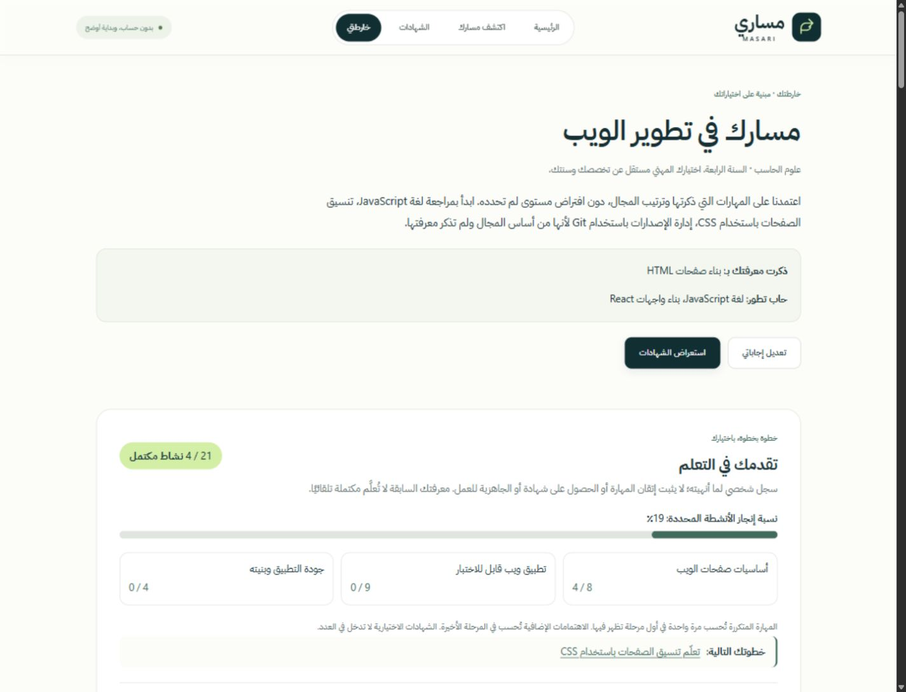

# Phase 5 — Anonymous Learning Progress Tracking

Implementation and verification date: **2026-10-26**. Student-facing content remains Arabic RTL; this technical report is in English.

## 1. Phase Summary

Implemented manual, reversible completion for roadmap skills, practical milestones and recommended learning resources. The roadmap shows recorded activity totals, an honestly labeled percentage, stage totals and a button focusing the next unfinished activity. Session-only storage is the default; device persistence requires explicit opt-in. Saved-roadmap resume, confirmed replacement/reset/removal and in-memory fallback are included.

The existing React/Vite/TypeScript/HashRouter/local-data architecture, three-stage timeline, branding, fonts and palette remain. No backend, account, external API, state-management dependency, new credential, new track, playback monitoring, notification or gamification was introduced. The 70 credentials, 11 tracks, 68 skills and 39 learning resources remain intact. Both recommendation engines and the catalog data are unchanged.

## 2. Files Created or Modified

Created:

- `src/types/progress.ts` — versioned progress, saved envelope and activity types.
- `src/utils/roadmapProgress.ts` — stable milestone identity, unique activities, validation, reconciliation, toggles and summaries.
- `src/utils/progressStorage.ts` — validated session/device serialization, consent gate and answer identity.
- `src/utils/progressStore.ts` — injectable memory store, persistence, resume, reset and removal operations.
- `src/hooks/useLearningProgress.ts` — browser adapters and React subscription/effect integration.
- `src/components/roadmap/CompletionControl.tsx` — labeled native checkboxes and completed feedback.
- `src/components/roadmap/ProgressSummary.tsx` — count/stage summary, next activity, storage/privacy and confirmations.
- `src/components/roadmap/SavedRoadmapNotice.tsx` — explicit saved-roadmap resume and device-data removal.
- `src/styles/progress.css` — compact responsive controls and summary, preserving existing design tokens.
- `scripts/validate-progress.ts` — dependency-free progress tests.
- `docs/screenshots/roadmap-progress.jpg` — real production-preview screenshot with synthetic answers.
- `PHASE5_REPORT.md` — this report.

Modified:

- `src/pages/RoadmapPage.tsx` — current session/answer source, progress integration and updated privacy text.
- `src/components/roadmap/RoadmapStageCard.tsx` — skill and practical milestone controls.
- `src/components/roadmap/LearningResourcesSection.tsx` — separate manual resource completion.
- `src/pages/HomePage.tsx` — saved-roadmap entry.
- `src/pages/QuestionnairePage.tsx` — accurate explanation of optional persistent answer saving.
- `src/hooks/usePageMotion.ts` — roadmap heading reveals exclude stateful controls and stage containers.
- `package.json` — `validate:progress`, included in the production build.
- `README.md` — progress, counting, privacy, resume, reconciliation and limits.

No dependency or lockfile change was needed. Historical reports were preserved.

## 3. Progress Tracking Model

The minimum typed `RoadmapProgress` contains `version: 1`, `trackId`, `completedSkillIds`, `completedMilestoneIds` and `completedResourceIds`. Skills/resources use existing canonical IDs. A practical milestone uses `track:stage:practice`, independent of translated text and array positions. There is no professional credential completion state.

The version-1 saved envelope contains `answers`, `progress` and `deviceOptIn`. Answers pass the existing strict questionnaire validator. It does not store generated recommendations, certification descriptions, UI structures, personal identification or timestamps. Generated activities are regenerated from the current deterministic engines and catalogs.

Pure functions build the activity list, toggle an existing activity, reconcile current scope, calculate summaries and select the next unfinished activity. Browser operations are injected through storage ports; React subscribes through its built-in `useSyncExternalStore`. No network operation is part of progress tracking.

## 4. Progress Counting Rules

Each displayed canonical skill counts once globally, assigned to its first displayed stage. Repeated controls reflect the same completion; a revisit does not add a second activity. Additional interests not represented in stages count in the final stage. Each of the three practical milestones and each unique recommended resource counts once. All displayed resources are tracked choices, not a claim that every course is mandatory.

Stage counts partition the same unique total. Next activity follows stages in order: priority skills, remaining skills, resources, practical milestone, then additional interests. Completing or undoing an activity updates counts without changing recommendations. Optional credentials and all credential alternatives are excluded entirely.

The Arabic percentage label is **نسبة إنجاز الأنشطة المحددة**. Self-reported prior knowledge starts incomplete. Opening a course/video does not complete it. A checked box never establishes competence, credential attainment, eligibility or employment readiness. Advanced credential warnings and unknown prices remain unchanged.

## 5. Storage and Privacy

| Storage                        | Key                          | Behavior                                                                     |
| ------------------------------ | ---------------------------- | ---------------------------------------------------------------------------- |
| Existing questionnaire session | `masari_questionnaire_v1`    | Existing validated submission flow, kept separate                            |
| Learning session               | `masari_learning_session_v1` | Active validated answers/progress; default session-only mode                 |
| Optional device snapshot       | `masari_learning_device_v1`  | Written only after explicit device-save action; requires `deviceOptIn: true` |

The Arabic save control explains that no account is created, answers/progress are stored locally, people using the browser profile may access them, clearing browser data can permanently remove them, and data does not synchronize across devices. Unchecking removes the persistent key. A confirmed remove action is available on the roadmap and homepage saved-roadmap entry. Session progress remains after device removal. Questionnaire reset alone does not delete the separate learning session or device snapshot.

Malformed shapes, duplicate IDs and unsupported envelope/progress versions are rejected. Obsolete/catalog-invalid or no-longer-relevant activity IDs are pruned. Invalid answer IDs or track mismatches reject the envelope before regeneration. Missing APIs, blocked getters/reads/writes/removal and quota failures are caught. The app keeps working in memory across routes; reload may lose unsaved work. Failed deletion visibly warns that old data may remain, rather than claiming removal succeeded. Browser site-data settings provide an independent removal mechanism.

## 6. Resume Functionality

A valid opted-in device snapshot enables **متابعة مساري السابق** on the homepage and empty roadmap. It is not automatically opened over a current roadmap. Confirmation explains replacement of the active learning session. Resume revalidates the snapshot, regenerates recommendations, restores relevant completion IDs and leaves the questionnaire's separately stored submission untouched. The header's **خارطتي** returns to the current active session.

One device snapshot is supported. Saving a revised/other roadmap asks for replacement confirmation. A snapshot changed by another tab is rechecked before replacement; automatic progress updates will not silently overwrite saved answers for a different roadmap. Same-answer concurrent progress remains last-write-wins, without synchronization or merging.

## 7. Answer-Change Reconciliation

- Same track: retain completed skills, milestone IDs and resource IDs only if still present in the regenerated activity set. New activities start incomplete; obsolete activities are discarded.
- Different track: start fresh, including skills whose canonical IDs are shared with the previous track. There is one active scope rather than a multi-profile history.
- Any meaningful answer change pauses device saving. The old snapshot remains until confirmed replacement or explicit removal. Reordering skill selections alone is ignored for identity.
- Reset: a reviewable confirmation offers cancellation before clearing active completion. Answers remain; an enabled device snapshot is updated accordingly.

Progress does not feed into either recommendation engine. Stable IDs, not self-reported knowledge or translated labels, control reconciliation. Future substantive milestone changes should receive a new stable ID or schema migration if prior completion should no longer apply.

## 8. UI and Accessibility

Native labeled checkboxes are keyboard operable, reversible and show clear incomplete/completed feedback. Totals are announced politely; the next-activity button focuses a real checkbox with a visible keyboard outline and sticky-header scroll margin. Counts use explicit LTR isolation inside the RTL interface. Reset/replacement/removal provide inline confirmation and cancellation; focus returns after summary confirmations. The mobile menu retains Escape-close and focus return.

The three-stage timeline remains. Compact CSS feedback respects reduced motion. GSAP continues enhancing the homepage and roadmap headings, with no animation attached to completion controls or their containing stage blocks. The summary does not animate on every state update.

## 9. Automated and Browser Test Results

Automated results from the final implementation build:

| Check                                 | Result | Evidence                                                                                                                         |
| ------------------------------------- | ------ | -------------------------------------------------------------------------------------------------------------------------------- |
| `npm run lint`                        | PASSED | ESLint, zero warnings allowed                                                                                                    |
| `npm run typecheck`                   | PASSED | Strict application and Node script checks                                                                                        |
| `npm run validate:catalog`            | PASSED | 70 credentials, 12 providers, 68 skills, 11 tracks, 33 stages; 44 invalid-data cases, 3 status cases, 8 search/filter assertions |
| `npm run validate:questionnaire`      | PASSED | 9 groups                                                                                                                         |
| `npm run validate:roadmap`            | PASSED | 24 regression groups                                                                                                             |
| `npm run validate:learning-resources` | PASSED | 24 groups; 39 resources, all 11 tracks                                                                                           |
| `npm run validate:progress`           | PASSED | 24 groups described below                                                                                                        |
| `npm run build`                       | PASSED | All five validators plus Vite production output                                                                                  |

The progress suite covers empty state, prior knowledge remaining incomplete, skill completion/undo, stable reversible milestones, manual resources, multiple and shared skills, credential exclusion, total/stage counts, next unfinished activity, session save/restore, explicit local opt-in, non-automatic resume, missing consent rejection, blocked storage, corrupted JSON, unsupported versions, malformed/obsolete/irrelevant IDs, same-track editing, different-track isolation, preserved device snapshot until replacement, clearing device data, reset semantics, write failures, different-answer tab conflicts, all eleven tracks and unchanged recommendation/catalog output.

Actual browser tests used the in-app browser against the local production build, with synthetic answers only:

| Scenario                                        | Result  | Observed evidence                                                                                                                                                                                       |
| ----------------------------------------------- | ------- | ------------------------------------------------------------------------------------------------------------------------------------------------------------------------------------------------------- |
| Homepage → questionnaire → roadmap              | PASSED  | CS/third-year/web, known HTML, desired JavaScript/React; initially 0/21 activities                                                                                                                      |
| Record skill, milestone and resource completion | PASSED  | JavaScript + HTML + foundation project + resource produced 4/21; checkbox state was reversible                                                                                                          |
| Navigation and session reload                   | PASSED  | 4/21 survived catalog navigation, roadmap return and reload                                                                                                                                             |
| Resource opening independent from completion    | PASSED  | Opened unfinished Elzero CSS plan in a new tab; still 4/21; publisher page loaded                                                                                                                       |
| Device save and new-session resume              | PASSED  | Explicit opt-in; reload retained enabled saving; disposable QA button cleared synthetic session only; homepage resume confirmation restored 4/21                                                        |
| Edit answers and replace snapshot               | PASSED  | Changed academic year and desired skills; relevant 4 activities retained, saving paused; replacement cancellation and confirmation both exercised                                                       |
| Change career track                             | PASSED  | Web → cybersecurity started 0/20 with a separate-scope explanation                                                                                                                                      |
| Reset cancellation/confirmation                 | PASSED  | Cancellation retained 4/21; confirmation produced 0/21                                                                                                                                                  |
| Clear persistent data / opt out                 | PASSED  | Roadmap removal confirmed; opt-in then uncheck removed persistent snapshot; homepage removal cancellation and confirmation also tested                                                                  |
| Anonymous questionnaire after removal           | PASSED  | Edited/generated again without account or dependence on device data                                                                                                                                     |
| Blocked browser storage                         | PASSED  | Disposable preview fixture made both storage getters throw; completed questionnaire, checked HTML, navigated away/back and retained 1/22 in memory; failed save showed notice and did not enable saving |
| Corrupt/unsupported stored records              | PASSED  | Disposable fixture seeded malformed session JSON and version-99 local data; Arabic rejection notice, normal questionnaire/session fallback and working roadmap                                          |
| Official certification link                     | PASSED  | Cisco CCST page opened and loaded in a separate tab                                                                                                                                                     |
| Responsive layouts                              | PASSED  | Homepage, catalog, roadmap and all four questionnaire steps checked at 320, 390, 768, 1024 and 1440 px; no horizontal overflow; 320 px catalog separately reconfirmed after route rendering             |
| RTL / unique anchors / keyboard                 | PASSED  | RTL root, unique DOM IDs, shared activity identity, native checkbox interaction, next-activity Enter moved focus with a 3 px outline; mobile Escape restored menu-toggle focus                          |
| Reduced-motion JavaScript branch                | PASSED  | Disposable `matchMedia` fixture skipped GSAP preload/inline motion; cybersecurity checkbox changed 0/20 → 1/20                                                                                          |
| Native OS reduced-motion switching              | NOT RUN | Browser capability exposes no media/OS preference control; CSS reduced-motion rule inspected separately                                                                                                 |
| Screen-reader and multiple browser engines      | NOT RUN | Native controls/labels reviewed; no actual assistive-technology or cross-engine claim                                                                                                                   |
| Application console                             | PASSED  | No errors/warnings in exercised production and blocked-storage journeys                                                                                                                                 |

All temporary QA fixtures lived under ignored `dist/__qa__/`; the final production build removed them. The screenshot is an actual browser capture, not a design mockup. All eleven tracks are covered automatically; full browser journeys focused on web development and cybersecurity.

## 10. Known Limitations

- Completion is self-reported; no tests of mastery or external course/video/platform activity exist.
- One active session and one device snapshot; no roadmap history, cloud backup or device synchronization.
- Storage is browser-profile-local and unencrypted. Browser session restoration policies vary; blocked storage/reload can lose work. If browser deletion is blocked, use its site-data settings.
- No cross-tab live UI sync or merge; same-answer concurrent writes are last-write-wins. Different-answer overwrite is guarded at write time.
- Catalog/template maintenance can change relevant activities and totals; IDs are pruned, with no historical denominator or content-version migration.
- All displayed resources count, though students may choose which to study; the count is a record of selected roadmap activities, never a mandatory course checklist.
- Native OS motion changes, screen readers and other browser engines were not tested.

Final local Vite output: entry JS approximately 499.04 kB (135.83 kB gzip), CSS 54.23 kB (11.19 kB gzip). Existing GSAP and ScrollTrigger remain separate lazy chunks. No new runtime dependency, remote feed, embed or image request was introduced by progress tracking. These are build sizes, not a Lighthouse score or runtime performance guarantee.

## 11. GitHub Commit and Deployment Status

Repository: [Mohammed-Alharbi-1/masari](https://github.com/Mohammed-Alharbi-1/masari), PUBLIC, branch `main`. Initial verified baseline: `9ac2c491a8e35f2915206f290d3082176eaf73fd`. Authentication succeeded using the existing GitHub CLI keyring session, and the initial fetch showed HEAD/origin/main at 0/0 divergence with a clean tree.

Publication is pending final staged review and push at this report snapshot. No remote deployment success is claimed yet. The required implementation commit message is `feat: add anonymous roadmap progress tracking`. Actual commit and deployment evidence will be recorded after publication.

The existing GitHub Pages workflow is unchanged. It installs dependencies, runs lint and build (including progress validation), uploads `dist/` and deploys to the `github-pages` environment. For a new fork, use Settings → Pages → Source → GitHub Actions and permit the default branch in environment protection settings. No additional configuration is expected for the existing configured repository.

## 12. Next-Phase Readiness

Phase 5 supplies small pure progress functions, injected storage ports and stable IDs for final quality/release review. Any later schema change should define migration or explicit invalidation, without treating progress as independently verified competence. No future phase functionality has been implemented.
