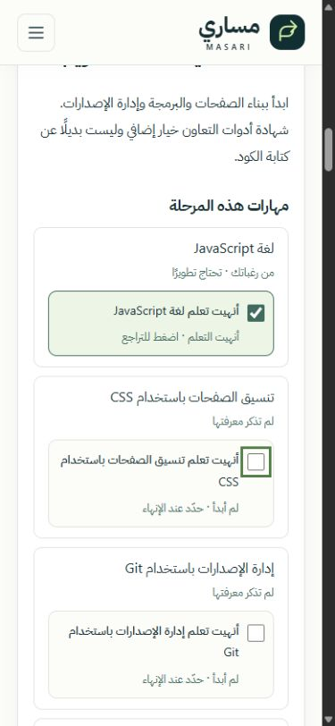

# Masari Phase 6 — Final Quality Assurance and Release Readiness

Audit date: **2026-10-26**. Repository: [Mohammed-Alharbi-1/masari](https://github.com/Mohammed-Alharbi-1/masari). Branch: `main`. Starting commit: `f1b6055413970ca1a822f778cb4b5fbecbbfb29f`.

## 1. Executive Summary

Release decision: **READY WITH LIMITATIONS**, subject to the publication evidence in section 13. No known release-blocking defect remains in the tested flows. This is a scoped release-candidate audit, not WCAG certification, a penetration test, or a cross-browser/device guarantee.

Preserved the React/Vite/TypeScript/HashRouter/local-data architecture, Arabic RTL interface, branding, palette, local fonts, GSAP enhancement, 70 professional credentials, 11 tracks, 68 skills, 39 resources, questionnaire, deterministic recommendations and anonymous progress tracker. No account, backend, external API integration, new track, algorithm expansion or dependency was introduced. Historical reports remain intact.

Fixed a demonstrated saved-roadmap confirmation race, a cancellation focus-return issue and one inaccurate resource-access statement. Added missing text Open Graph metadata and deployment-aware root canonical URLs. Automated checks, a 99-scenario recommendation matrix, publisher-page reinspection and the available in-app browser were used; their coverage limits are explicit below.

## 2. Tested Application Features

These are **local production-build browser tests**, using synthetic anonymous answers only, unless another method is stated.

| Feature / scenario                                | Result | Evidence                                                                                                                                                                                                     |
| ------------------------------------------------- | ------ | ------------------------------------------------------------------------------------------------------------------------------------------------------------------------------------------------------------ |
| Homepage and all career directions                | PASSED | Clicked all 11 career-card links and verified their catalog filter/result counts: web 6, software 14, cyber 16, networking 5, cloud 37, DevOps 18, analytics 11, AI 4, databases 6, IT support 13, testing 4 |
| Catalog search and empty recovery                 | PASSED | GitHub Foundations produced 1/70; a nonexistent term produced 0/70; clearing restored browsing; all 11 filter selections exercised                                                                           |
| Required academic inputs                          | PASSED | Blank Next focused `major`; selecting major/year advanced the form                                                                                                                                           |
| Required career selection                         | PASSED | Blank selection stayed on the fieldset; choosing a native radio advanced correctly                                                                                                                           |
| Existing and desired skill selection              | PASSED | Selected known HTML and desired JavaScript/React independently; known HTML was not automatically complete                                                                                                    |
| Optional preferences                              | PASSED | Skipped all optional preferences and generated a valid roadmap                                                                                                                                               |
| Roadmap generation                                | PASSED | Three stages, skills, practical tasks, optional credentials and relevant free resources; initial 0/21 for the web sample                                                                                     |
| Recommendations across profiles                   | PASSED | Pure-function matrix: 11 tracks × 3 knowledge levels × 3 skill profiles = 99 scenarios, plus the existing regression suites                                                                                  |
| Official issuer link                              | PASSED | Opened GitHub Foundations in a separate tab and loaded the official Microsoft Learn credential page                                                                                                          |
| Learning-resource link                            | PASSED | Opened the public Elzero JavaScript playlist in a separate tab; roadmap completion stayed at 0/21                                                                                                            |
| Completion and undo                               | PASSED | Marked a skill, practical milestone and resource; undo reduced recorded completion from 3 to 2; rechecking restored 3                                                                                        |
| Session navigation/reload                         | PASSED | Recorded 3/21 survived navigation and reload; generated controls remained usable                                                                                                                             |
| Device saving and explicit resume                 | PASSED | Enabled persistence; disposable QA fixture cleared only the synthetic session; homepage offered resume rather than opening automatically; confirmation restored the saved roadmap                            |
| Same-track answer changes                         | PASSED | Cybersecurity academic-year edit retained relevant 3/20 activities and paused device saving                                                                                                                  |
| Changed career track                              | PASSED | Changing from cybersecurity to web started 0/21; unrelated progress was not inherited                                                                                                                        |
| Snapshot replacement                              | PASSED | Both cancellation and confirmed replacement were exercised                                                                                                                                                   |
| Progress reset                                    | PASSED | Cancellation retained 3/20; confirmation changed it to 0/20 without clearing answers                                                                                                                         |
| Persistent-data removal and opting out            | PASSED | Confirmed removal and unchecking removed device saving; current session progress remained; no account was required afterward                                                                                 |
| Another tab changes the saved scope during resume | PASSED | Browser fixture changed web to cyber while confirmation was open; resume stopped with a review notice and restored trigger focus; a fresh confirmation opened cyber at 0/20                                  |
| Blocked storage                                   | PASSED | Fixture made both storage getters throw; questionnaire and roadmap worked, HTML completion survived route navigation at 1/22, failed device save showed a notice and did not enable saving                   |
| Corrupt/unsupported stored data                   | PASSED | Malformed session JSON and a version-99 device envelope were rejected with Arabic notice; valid questionnaire fallback still generated a roadmap                                                             |
| Application console                               | PASSED | No application errors/warnings in the exercised normal and blocked-storage flows                                                                                                                             |

The matrix verified deterministic, non-mutating output, three stages, retained technology-neutral foundations, optional certification flags, future advanced goals, unique bounded resources and zero automatic completion. Existing tests independently cover JavaScript/Python separation, desired technologies, separate cloud vendors, eligibility warnings, prices remaining unknown and useful stages without certificates. The matrix is supporting audit evidence rather than a new recommendation algorithm or permanent testing framework.

## 3. Bugs Found and Fixed

| Finding                                                     | Severity | Before                                                                                                                         | Resolution and verification                                                                                                                                                                                                                                                         |
| ----------------------------------------------------------- | -------- | ------------------------------------------------------------------------------------------------------------------------------ | ----------------------------------------------------------------------------------------------------------------------------------------------------------------------------------------------------------------------------------------------------------------------------------- |
| Saved roadmap changed after resume confirmation opened      | Medium   | **FAILED:** a direct reproduction offered web but opened a newer cyber snapshot written by another tab, without renewed review | **PASSED:** `resume` compares the actual current snapshot with the one reviewed. On mismatch it keeps the active roadmap, updates the saved-scope notice and requires a new confirmation. New unit regression and actual two-tab browser reproduction passed                        |
| Homepage removal cancellation returned to the wrong trigger | Low      | **FAILED:** canceling device-data removal focused the resume button                                                            | **PASSED:** separate trigger refs restore the initiating removal control; browser focus inspection confirmed the correct text. Rejected/unavailable resume also restores a useful focus target                                                                                      |
| Public GitHub repository described as mandatory             | Low      | **FAILED:** the Introduction to GitHub note implied public visibility was required                                             | **PASSED:** official GitHub Skills instructions recommend public visibility because private repositories may consume Actions minutes. Corrected the Arabic wording, preserving account/usage disclosures; only this corrected record's verification date was advanced to 2026-10-26 |
| Missing Open Graph / canonical metadata                     | Low      | **FAILED** metadata completeness review: neither was present                                                                   | **PASSED:** added Arabic text social metadata and build-time canonical/`og:url`; checked local, normal project, renamed project, user site and custom domain cases                                                                                                                  |

No redesign or speculative performance refactor was made. Existing search/helper timings did not demonstrate a bottleneck requiring a new cache or state-management layer.

## 4. Accessibility Findings

| Method and check                           | Result  | Evidence / limit                                                                                                                                                                                                                                                                                                                                             |
| ------------------------------------------ | ------- | ------------------------------------------------------------------------------------------------------------------------------------------------------------------------------------------------------------------------------------------------------------------------------------------------------------------------------------------------------------ |
| Source and rendered semantics              | PASSED  | One application h1 on tested pages; meaningful stage headings, lists, native form fields and labels; unique roadmap anchors; Arabic language and RTL root                                                                                                                                                                                                    |
| Required validation and focus              | PASSED  | Blank academic and career steps retained the current step and focused a useful invalid control/group                                                                                                                                                                                                                                                         |
| Keyboard and visible focus                 | PASSED  | Next-activity Enter moved focus to a real activity checkbox with a 3 px solid outline; native completion controls remained operable                                                                                                                                                                                                                          |
| Mobile navigation                          | PASSED  | Menu expanded; Escape closed it and returned focus to the menu toggle                                                                                                                                                                                                                                                                                        |
| Confirmation interfaces                    | PASSED  | Inline labeled groups offer explicit confirm/cancel, rather than claiming to be modal dialogs; cancellation focus and changed-snapshot rejection focus were tested                                                                                                                                                                                           |
| Labels and announcements                   | PASSED  | Tested catalog fields and roadmap checkboxes had labels; catalog result count, progress total and notices use polite/live status semantics in source                                                                                                                                                                                                         |
| Computed text-color screening              | PASSED  | Catalog screening covered 1,465 rendered text elements with no contrast failure; skill-step screening 96 and roadmap screening 297 likewise had none. Homepage meaningful text was checked separately after transitions settled. Decorative illustration symbols within the labeled image/`aria-hidden` artwork were excluded from text-contrast conclusions |
| Target-size sampling                       | PASSED  | Primary buttons 50 px high, resource-start links 44 px, text-action buttons 44 px, save label 30 px, and full completion labels 69–76 px in sampled desktop layouts; narrow-layout controls remained within the viewport. This is not exhaustive certification of every WCAG target-spacing exception                                                        |
| Reduced-motion JavaScript behavior         | PASSED  | Disposable `matchMedia` fixture skipped GSAP preloads/inline motion; manual completion changed 0/21 → 1/21                                                                                                                                                                                                                                                   |
| Reduced-motion CSS and animation isolation | PASSED  | Source review: CSS disables transitions/animations for reduce; GSAP targets headings rather than stateful completion controls                                                                                                                                                                                                                                |
| Actual screen-reader output                | NOT RUN | No usable speech/transcript testing was exposed through the available browser QA controls; source/DOM/keyboard review is not an actual assistive-technology session                                                                                                                                                                                          |
| Native browser zoom / OS magnifier         | NOT RUN | Viewport reflow was tested, including 320 px, but no claim of actual 200% browser zoom or OS magnification testing                                                                                                                                                                                                                                           |
| Native OS reduced-motion switching         | NOT RUN | Browser controls expose viewport/visibility, not OS/media preference emulation                                                                                                                                                                                                                                                                               |

The contrast screening uses computed foreground/background colors and ordinary WCAG text-size thresholds. It is a practical screening aid, not a comprehensive accessibility scanner: imagery, every interaction state, assistive technology and all perceptual conditions are not covered. No WCAG 2.2 AA certification is claimed.

## 5. Responsive and Browser Testing

**PASSED:** 40 viewport samples at **320, 390, 768, 1024 and 1440 px** across the homepage, catalog, all four questionnaire steps, roadmap and confirmation interface. No horizontal document overflow or tested control outside the viewport was detected. Sample details are in [phase6-check-evidence.json](docs/phase6-check-evidence.json).

Header, menu, hero, career cards, catalog controls/grid, questionnaire selections, stage timeline, resource/completion cards, confirmations and footer were inspected through rendered layout, keyboard actions and screenshots. The actual mobile screenshot below shows wrapping, completion feedback and keyboard focus at 390 px. These are browser viewport simulations, not physical-device tests.

| Browser/device coverage                 | Result  |
| --------------------------------------- | ------- |
| Available ChatGPT in-app browser        | PASSED  |
| Independent Chromium run/version matrix | NOT RUN |
| Firefox                                 | NOT RUN |
| WebKit/Safari                           | NOT RUN |
| Physical phones/tablets                 | NOT RUN |

The exposed browser inventory contained the in-app browser and an MCP Apps surface; it did not provide independent Firefox/WebKit/Chrome sessions. Engine/version-specific compatibility is not inferred from the in-app result.

## 6. Performance Results

**PASSED — production asset inspection.** Sizes below use actual file bytes and Node `gzipSync`, consistently for baseline and final. Decimal kB; gzip values may differ slightly from Vite's own printed compressor estimates.

| Asset              | Phase 5 baseline raw / gzip | Phase 6 raw / gzip      |
| ------------------ | --------------------------- | ----------------------- |
| Entry JavaScript   | 499,047 / 134,907 bytes     | 499,474 / 135,030 bytes |
| CSS                | 54,239 / 11,113 bytes       | 54,239 / 11,113 bytes   |
| Lazy GSAP          | 69,931 / 27,192 bytes       | Unchanged               |
| Lazy ScrollTrigger | 42,736 / 17,422 bytes       | Unchanged               |

The targeted runtime fixes add 427 raw bytes and 123 gzip bytes to the entry; no dependency was added. Four local WOFF2 font weights loaded in the sampled browser request list; WOFF fallbacks were not also requested. The roadmap/mobile documentation screenshots are not part of the Vite application assets. The homepage illustration remains local HTML/SVG rather than a remote image.

**PASSED — measured local sample, with limits.** An ignored instrumented production HTML page used browser PerformanceObserver/Navigation Timing and exposed results in a visible QA panel. One unthrottled desktop localhost sample recorded:

- FCP: **88 ms**; LCP observation: **216 ms**.
- CLS observation: **0.0212193** during the sampled load.
- DOMContentLoaded end: **78.6 ms**; load end: **96.1 ms**.
- One long task: **76 ms**, also the total/max observed long-task duration.
- Eight recorded resources: entry JS, CSS, four local fonts and the two deferred animation chunks; no third-party data/telemetry request in that sample.

These values are local lab observations with no throttling and no controlled-cache/field population. The instrumented page and QA panel are not shipped. They are not Lighthouse, mobile-network, field Core Web Vitals, memory-leak or Interaction to Next Paint measurements.

**PASSED — search helper timing.** 600 actual unthrottled Node calls across representative Arabic/English/code/empty-result queries: median **0.4897 ms**, p95 **0.7564 ms**. This measures only the pure helper, not browser rendering or keyboard latency. No slow search behavior was demonstrated in browser testing.

**PASSED — deferred enhancement/source review.** Direct catalog loading had no GSAP preload. Homepage loading requested the lazy animation chunks; route cycles and progress changes retained usable content. No scroll hijacking, pinning, per-checkbox GSAP work or remote feeds were added. Existing code scopes and reverts the animation context. No profiler-derived claim about React render counts or memory leaks is made.

| Additional performance audit                   | Result                                                                    |
| ---------------------------------------------- | ------------------------------------------------------------------------- |
| Lighthouse                                     | NOT RUN — CLI not found on PATH; no Lighthouse audit result was available |
| Field Core Web Vitals / throttled mobile audit | NOT RUN                                                                   |
| React Profiler / heap-leak profiling           | NOT RUN                                                                   |

Raw asset, responsive, recommendation-matrix and lab evidence: [phase6-check-evidence.json](docs/phase6-check-evidence.json).

## 7. Learning Resource Verification

**PASSED — all 39 existing destinations received substantive dated publisher/content-access review**, with the single copy error corrected. No broken destination was demonstrated and no replacement/new resource was needed. The per-record evidence, original extraction limits, correction and supplemental browser checks are retained in [phase6-resource-audit.json](docs/phase6-resource-audit.json). Original Phase 4.5 evidence remains in `docs/resource-verification.json`.

The audit checked HTTPS destinations, topic/skill relevance, publisher, Arabic/English language, public/free-study statements, registration caveats and the separation between educational content and professional examinations. A status-200 response was not treated as sufficient evidence. Representative actual lessons/modules, official access-policy pages and topic outlines were inspected.

Web extraction initially could not inspect two YouTube and three Cisco JavaScript-rendered pages. Supplemental real-browser checks resolved that limitation: signed-out Elzero HTML/JavaScript playlists showed their expected publisher, public lesson lists and Play actions; the three Cisco destinations rendered Arabic course overviews, the Arabic language option, explicit FREE labels and login/sign-up/self-paced controls. No enrollment or playback automation was used.

**NOT RUN:** completing every course, playing every video, enrolling, account-only lessons and future availability. Cisco account-only behavior and other registration flows were not independently executed. Linux Foundation still disclosed $0 access with login and a 90-day window. Cloud documentation, Excel/tool usage and GitHub private Actions caveats remain distinguished from free reading. No exam price or Saudi reimbursement claim was fabricated. Verification badges were not bulk-redated; only the corrected, directly reinspected GitHub introduction record changed date.

## 8. Privacy and Storage Review

| Review / test                   | Result | Evidence                                                                                                                                                     |
| ------------------------------- | ------ | ------------------------------------------------------------------------------------------------------------------------------------------------------------ |
| Anonymous inputs                | PASSED | No name, email, account or identifying field; existing validators reject extra identity keys                                                                 |
| Session-only default            | PASSED | Progress and questionnaire use their separate versioned session keys; default completion does not write device data                                          |
| Explicit device consent         | PASSED | Valid persistent envelope requires `deviceOptIn: true`; UI checkbox action is necessary; replacement requires confirmation                                   |
| Safe resume                     | PASSED | Saved answers are validated before regeneration; no automatic overwrite of the questionnaire submission; changed-snapshot race is now guarded                |
| Unchecking / clear action       | PASSED | Removes `masari_learning_device_v1`; session progress remains; failure notices do not claim successful deletion                                              |
| Reset explanation               | PASSED | Progress reset clears active completion, retaining answers and updating an enabled snapshot; confirmation/cancellation tested                                |
| Untrusted restore               | PASSED | Strict versions/shapes, answer validation and current activity/catalog ID reconciliation; malformed/obsolete records rejected or pruned                      |
| Blocked reads/writes/removal    | PASSED | Existing automated storage-port tests and actual blocked-storage browser flow; app remains usable in memory                                                  |
| Track separation                | PASSED | Both automated and browser checks reject unrelated completion inheritance                                                                                    |
| Data transmission source review | PASSED | No application `fetch`, XHR, beacon, WebSocket or HTML-execution API found; external links do not append questionnaire/progress data and use safe rel values |

Storage is unencrypted and visible to other users of the browser profile. Browser clearing/restore policies vary. There is one active session and one device snapshot, no cloud backup or synchronization. Same-answer concurrent edits remain last-write-wins; the new resume guard prevents a different unreviewed snapshot from opening but is not a cross-tab merge system. Failed removal requires retry or the browser's site-data settings. These limitations are disclosed, not described as guaranteed private storage.

## 9. Security and Dependency Findings

| Check                                                     | Result  | Evidence / scope                                                                                                                                        |
| --------------------------------------------------------- | ------- | ------------------------------------------------------------------------------------------------------------------------------------------------------- |
| `npm audit --json`                                        | PASSED  | 0 known advisories: info/low/moderate/high/critical all zero, 190 dependencies reported at audit time                                                   |
| Dependency versions/lockfile                              | PASSED  | Lockfile and dependency versions unchanged; no new testing or animation package introduced                                                              |
| External links                                            | PASSED  | HTTPS/catalog validators plus rendered target-blank links checked for `noopener noreferrer`                                                             |
| Storage parsing / HTML injection review                   | PASSED  | JSON restoration validates before rendering; no `dangerouslySetInnerHTML` or application eval API found                                                 |
| Environment/generated-file hygiene                        | PASSED  | Existing ignore rules cover environment/credential files, node_modules, build output, coverage and tsbuildinfo; final build removes ignored QA fixtures |
| GitHub Actions permissions                                | PASSED  | Source review: top-level contents read, build pages read, deploy pages write/id-token write; official actions remain pinned by full commit SHA          |
| Canonical configuration                                   | PASSED  | Local builds omit public URL tags; repo/user-site/renamed/custom cases checked; public override rejects non-HTTPS, credentials, queries and hashes      |
| Staged secret/path review                                 | PASSED  | Reviewed the 12 staged files; forbidden paths, whitespace and secret-pattern checks passed before publication                                           |
| Independent penetration test / exhaustive advisory review | NOT RUN | npm's advisory snapshot and source checks are not a security certification                                                                              |

No repository visibility, secrets, unrelated repository, global Git identity or account setting was changed. No force push or repository deletion is used. Public metadata contains no questionnaire answers or progress. Root canonical/text social metadata supports the static Arabic document; HashRouter remains limited for per-route indexing, and no server-rendered SEO or dedicated preview image is claimed.

## 10. Files Changed

- `src/utils/progressStore.ts` — compare the reviewed snapshot at resume time and preserve the active roadmap on conflict.
- `src/components/roadmap/SavedRoadmapNotice.tsx` — pass the reviewed snapshot, restore the correct cancellation/error focus target.
- `scripts/validate-progress.ts` — targeted regression for a changed snapshot between confirmation and resume.
- `src/data/learningResources.ts` — correct GitHub introduction repository-visibility wording and that record's dated verification.
- `index.html` — current Arabic description and text Open Graph tags.
- `vite.config.ts` — deployment-aware root canonical and `og:url`, with safe custom-domain override.
- `docs/animation-notes.md` — align documentation with existing heading-only roadmap animation behavior.
- `docs/phase6-resource-audit.json` — all 39 resource audit records and limitations.
- `docs/phase6-check-evidence.json` — actual matrix, asset, responsive and local-lab evidence.
- `docs/screenshots/release-mobile-roadmap.jpg` — actual production-preview mobile screenshot.
- `README.md` — release status, evidence, corrected resume behavior, metadata and verification limits.
- `PHASE6_RELEASE_REPORT.md` — this report.

No certification catalog, track taxonomy, recommendation algorithm, deployment workflow, dependency/lockfile, historical report or architecture replacement was needed.

## 11. Automated Test Results

| Required command / audit              | Result | Evidence                                                                                                           |
| ------------------------------------- | ------ | ------------------------------------------------------------------------------------------------------------------ |
| `npm run lint`                        | PASSED | Zero-warning ESLint configuration                                                                                  |
| `npm run typecheck`                   | PASSED | Strict application/build/test-script types                                                                         |
| `npm run validate:catalog`            | PASSED | 70 credentials, 12 providers, 68 skills, 11 tracks, 33 stages; 44 invalid-data, 3 status and 8 search/filter cases |
| `npm run validate:questionnaire`      | PASSED | 9 groups                                                                                                           |
| `npm run validate:roadmap`            | PASSED | 24 groups                                                                                                          |
| `npm run validate:learning-resources` | PASSED | 24 groups; 39 resources remain                                                                                     |
| `npm run validate:progress`           | PASSED | 25 groups, including the new resume-race regression                                                                |
| `npm run build`                       | PASSED | TypeScript, all five validators and Vite output                                                                    |
| Supplemental recommendation matrix    | PASSED | 99 scenarios; exact audit scope in section 2 and JSON evidence                                                     |
| Metadata configuration matrix         | PASSED | Local, Masari, renamed project, user site, custom domain                                                           |

The required validators execute during the production build as actual npm commands. Tests were extended only for the identified resume regression. No large testing framework was added. The temporary QA pages and measurement scripts are audit tools, not production features.

## 12. Remaining Issues and Risk Severity

| Remaining limitation                                                                         | Severity                          | Release impact                                                                                                      |
| -------------------------------------------------------------------------------------------- | --------------------------------- | ------------------------------------------------------------------------------------------------------------------- |
| Actual AT output, native zoom/motion changes, independent browsers and real devices untested | Medium verification risk          | Non-blocking for this scoped candidate; obtain those checks before claiming broad accessibility/browser conformance |
| Lighthouse, throttled mobile and field Web Vitals unavailable                                | Low verification risk             | Local metrics and bundle sizes are documented; no public performance score or universal speed claim                 |
| External resources may change; account-only/full-course activity untested                    | Low ongoing content risk          | Dated evidence and access caveats remain; maintain/recheck publisher links                                          |
| Shared-profile local storage, clearing loss and same-answer concurrent writes                | Low documented product constraint | Explicit opt-in, removal and warnings; no encrypted/private-cloud or merge claim                                    |
| HashRouter indexing and no dedicated social preview image                                    | Low SEO limitation                | Root metadata only; architecture deliberately retained                                                              |

No known unresolved high-severity or release-blocking functional defect was found. Absence of a demonstrated defect is not proof of universal correctness or standards conformance.

## 13. GitHub Deployment Status

The initial tree was clean and the authenticated GitHub CLI fetch showed 0/0 divergence with `origin/main`. Repository and `main` were verified before editing. Required quality commit message: `chore: finalize Masari release quality and documentation`.

At this initial report snapshot, publication remains pending final review/staged scan. No Phase 6 remote deployment success is claimed yet. The actual quality commit SHA, Actions result, Pages verification and final documentation evidence will be recorded after safe publication. No release tag is created.

The existing Pages workflow remains unchanged and uses GitHub Actions. No manual Pages setting change is expected for the already configured repository. Public URL: [Masari](https://mohammed-alharbi-1.github.io/masari/).

## 14. Release Readiness Decision

**READY WITH LIMITATIONS.** The existing product is functional in tested flows, important demonstrated defects have targeted fixes, and the documented quality gates pass locally. This decision remains qualified by the verification gaps in section 12 and publication evidence in section 13. No future feature phase has been started, and no WCAG, exhaustive security, cross-device or field-performance certification is asserted.
