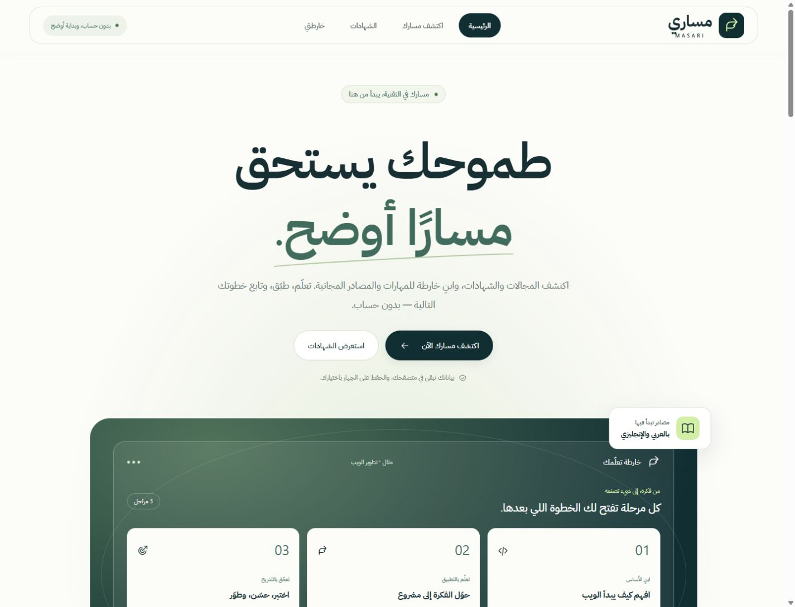

# Phase 7 — debugging, security and premium frontend

## 1. Executive Summary

Implemented and verified on 2026-10-26–27 from clean synchronized `main` at `6d06684f26bd4f44e2dc75d1556db2b820a9b109`. Three confirmed functional/integrity/consent defects were fixed. Masari now has a visibly different editorial homepage, layered product visualization, guided questionnaire, clearer catalog and roadmap dashboard, and coordinated GSAP motion. The architecture, Arabic RTL UI, 70 certifications, 11 tracks, 68 skills, 39 resources and deterministic recommendation rules remain intact. No new runtime dependency was added.

Release decision: **READY WITH LIMITATIONS**, subject to the publication evidence in section 13. This is a bounded release assessment, not a security or accessibility certification.

## 2. Files Changed

| Area | Files / purpose |
| --- | --- |
| Application | `HomePage.tsx`, `QuestionnairePage.tsx`, `RoadmapPage.tsx`: new composition, validated active submission, timeline markup |
| Progress | `progressStore.ts`, `ProgressSummary.tsx`, `CompletionControl.tsx`: conflict/opt-out fixes, actual activity overview, native settings disclosure and concise controls |
| Presentation | `usePageMotion.ts`, new `styles/premium.css`, `main.tsx`: scoped optional motion and responsive design |
| Security/build | new `config/securityPolicy.ts`, `vite.config.ts`, `index.html`, `package.json`, new `.github/dependabot.yml`: build-only CSP, referrer metadata, validator and version-update configuration |
| Regression | `validate-progress.ts` (25→28 groups), new `validate-security.ts` (8 groups) |
| Evidence/docs | This report, `DEBUG_REPORT.md`, `SECURITY_AUDIT.md`, `DESIGN_REVIEW.md`, README, `docs/phase7-check-evidence.json`, 16 matched screenshots and live deployment proof |

Catalogs, recommendation algorithms, dependencies/lockfile versions and the existing deploy workflow were not changed. Temporary QA pages are excluded from release artifacts.

## 3. Debugging Results

1. New completed questionnaire answers now become the active learning context. Reproduced web→cybersecurity stale header navigation is fixed, including reload and Back/Forward.
2. Same-answer stale tabs and restored sessions no longer silently overwrite newer progress/undo in the tested sequence. Full snapshot comparison pauses saving and keeps the tab's temporary work.
3. Failed persistent deletion still revokes future automatic saving. The old copy is retained honestly and a visible warning explains manual recovery.

Real browser journeys and deterministic regressions verify these outcomes. [DEBUG_REPORT.md](DEBUG_REPORT.md) gives severity, reproduction, root cause and residual limits.

## 4. Security Findings and Fixes

Two confirmed medium local integrity/consent weaknesses were remediated. No confirmed remote XSS/prototype pollution, critical finding or high-severity exploitable finding was found. Production meta CSP is additional protection, not a claimed XSS repair or HTTP-header equivalent. An eight-group security suite rejects malformed/prototype/markup-like inputs, bad envelopes and unsafe destinations. Dependency audit found zero known advisories. Weekly Dependabot version updates cover npm and GitHub Actions.

[SECURITY_AUDIT.md](SECURITY_AUDIT.md) contains the finding table, trust boundaries, meta-CSP limits, actual enforcement results, workflow review and non-applicable backend categories.

## 5. Frontend Redesign

The compact split hero is replaced by a large centered Arabic headline, deliberate actions and a layered three-stage roadmap preview. Numbered steps, a career grid, dark learning story, actual resource examples and a closing action use varied compositions. The floating header preserves native navigation behavior. Catalog controls/results are visually separated and credential details stay secondary. Questionnaire progress sits beside the desktop form and above it on mobile. The roadmap has an identified career header, real activity dial/native progress, next action, clear stage panels and expandable privacy management.

The existing Masari green/navy palette is preserved. Preview/sample content is explicitly illustrative; no fake readiness score, certificate achievement or employment claim was added. [DESIGN_REVIEW.md](DESIGN_REVIEW.md) explains the reference principles and actual visual differences.

## 6. JavaScript Animations

- Coordinated hero GSAP timeline: eyebrow, headline, text, buttons, rising/scaling preview, staggered stage panels and floating details.
- Scroll storytelling and grouped step/career/resource reveals; no separate trigger for each catalog card.
- Decorative roadmap connection-line growth tied to scroll, plus stage-heading reveals.
- Scoped questionnaire heading transitions; no control remount or validation-focus animation.
- CSS interaction feedback; reduced-motion handling, route cleanup, late-import cancellation and readable failure fallback.

DOM sampling demonstrated actual changes in hero/career transforms and line scale. Four production navigation cycles returned to nine homepage triggers, zero on catalog exit. Development Strict Mode: 9 initially, 9 after three cycles, 0 after exit. Reduced-motion fixture: hero/career transforms remained `none`. Both lazy imports were deliberately blocked by a tightened QA CSP; navigation and content still worked. No screen recording capability was available: recording **NOT RUN**; reproducible steps are in the design review.

## 7. Screenshot and Visual Evidence

Eight matched before images and eight after images are in `docs/screenshots/phase7/before/` and `after/`. Desktop 1440×1100, mobile 390×844, real viewport screenshots. Home has no saved banner; catalog shows all 70; questionnaire starts empty at step one; roadmap uses synthetic CS/third-year/web answers, known HTML, desired JavaScript/React, null preferences, 0/21 activities. [All comparison links](DESIGN_REVIEW.md#matched-screenshot-evidence).

Those are requested CSS viewports. Exported bitmap widths are 1425/375; heights vary slightly between the baseline and final browser exports (1100/1089 desktop; 844/812 mobile). Original exports are retained; the evidence records actual per-file dimensions. These support visual composition comparison, not exact pixel diffs.

## 8. Responsive Testing

Measured home, catalog, questionnaire and roadmap at **320, 375, 390, 430, 768, 1024, 1440 and 1920px**: 32 route/width observations without document horizontal overflow. The questionnaire matrix used the submitted summary; first-step forms were independently inspected at desktop, 390px and narrow 320px. Desktop/mobile captures and lower-page career/timeline views were visually inspected. Menus, native disclosures, completion and resource links remain usable without hover. This is not an exhaustive visual audit of every activity at every width.

## 9. Accessibility Testing

Verified menu Escape/focus return, route title/main focus, required-field errors, native labels/selects/radios/checkboxes, details disclosure, explicit confirmations, manual completion/undo and next-activity focus. Reduced-motion simulation and import-failure fallback keep essential content available. Decorative SVG/preview content does not replace the labeled native progress/control semantics. Arabic RTL and English technical identifiers remain readable in inspected views.

Actual screen-reader use, native 200% browser zoom, OS preference switching, physical devices and independent browser engines: **NOT RUN**. No full WCAG 2.2 AA certification is claimed.

## 10. Performance Comparison

Same method: production preview on localhost, default 1280×720 viewport, external same-origin PerformanceObserver helper, no throttling, cache not controlled. One before and one final observation; no statistical or field-performance claim. The helper itself adds a small request/control and was not shipped. Raw assets measured with Node `gzipSync`, consistently for both builds.

| Metric | Before | Final after |
| --- | ---: | ---: |
| Entry JS bytes | 499,474 | 504,465 |
| Entry JS gzip bytes | 135,030 | 136,449 |
| CSS bytes | 54,239 | 72,749 |
| CSS gzip bytes | 11,113 | 14,395 |
| Lazy GSAP / ScrollTrigger bytes | 69,931 / 42,736 | unchanged |
| FCP | 76 ms | 112 ms |
| LCP | 200 ms | 112 ms |
| CLS | 0.00943 | 0.01043 |
| DCL / load | 70.2 / 89.9 ms | 81.5 / 101.8 ms |
| Observed long tasks | 1 (77 ms) | 0 |

JS increased about 1% (+4,991 bytes, gzip +1,419). CSS increased 18,510 bytes (gzip +3,282) for the new layouts/breakpoints. No large image or new animation payload was added; fonts remain self-hosted. The entry crosses Vite's 500 kB advisory threshold; its warning is retained. Local interaction/scroll testing found no noticeable slowdown, but uncontrolled cache and one run cannot establish a performance improvement. Lighthouse desktop/mobile and field Core Web Vitals: **NOT RUN**.

## 11. Automated Test Results

| Command | Result |
| --- | --- |
| `npm ci` | PASS; 165 installed, 166 audited. First repeat attempt hit Windows file locking; owned QA servers were stopped and retry passed. |
| `npm run lint` | PASS, zero warnings |
| `npm run typecheck` | PASS |
| `npm run validate:catalog` | PASS: 70/12/68/11/33; 44 invalid-data, 3 honest-status and 8 search/filter assertions |
| `npm run validate:questionnaire` | PASS: 9 groups |
| `npm run validate:roadmap` | PASS: 24 groups |
| `npm run validate:learning-resources` | PASS: 24 groups; 39 resources |
| `npm run validate:progress` | PASS: 28 groups |
| `npm run validate:security` | PASS: 8 groups |
| `npm run build` | PASS; runs TypeScript and all six validators; disclosed bundle warning |
| `npm audit --json` | PASS: 0 known vulnerabilities. Sandbox DNS failure retried with approved registry access. |
| `npm ls --depth=0` | PASS; installed tree consistent, no new dependencies |

The five existing validators and new security validator also run within the production build. [Machine-readable evidence](docs/phase7-check-evidence.json) records measurements and limitations.

## 12. Known Limitations

- Snapshot comparison is not an atomic multi-tab transaction. No automatic merge or cloud synchronization is promised.
- Browser storage is unencrypted, shares an origin/profile boundary and can fail or be cleared. Failed deletion may leave an older copy requiring site-data removal. Completely blocked session writes/removes limit revocation across reload.
- Meta CSP cannot provide framing/sandbox/reporting HTTP protections. An IAB fixture reported an unattributed inline-style violation; app styling and motion worked. Independent browser compatibility was not established.
- No actual AT/zoom/physical-device/independent-engine audit, recording, Lighthouse, field performance or external penetration test.
- The main entry is just over the bundler warning threshold. Catalog/resource verification remains dated; Phase 7 did not bulk-redate or re-certify all external pages.

## 13. GitHub Commit and Deployment

Repository: [Mohammed-Alharbi-1/masari](https://github.com/Mohammed-Alharbi-1/masari). Branch: `main`. Site: [Masari](https://mohammed-alharbi-1.github.io/masari/).

Implementation commit: [`d4b4aee56fe3a2ad6a94dd2397d0a585cb68ec08`](https://github.com/Mohammed-Alharbi-1/masari/commit/d4b4aee56fe3a2ad6a94dd2397d0a585cb68ec08), `feat: harden security and deliver premium Masari UI`. A normal push advanced `main` from the recorded baseline; no force push was used. The commit changes 38 files. Remote Git tree inspection confirmed the reports/source/screenshot paths and no `dist/` or `node_modules/` files.

[Actions run 40428220408](https://github.com/Mohammed-Alharbi-1/masari/actions/runs/40428220408) completed successfully: clean install, lint, TypeScript/build/validators, Pages artifact and deployment. Deployment completed **2026-10-27 00:44:15 UTC**. Pages API reports workflow-based hosting at the site above.

Actual deployed-browser checks passed: new hero headline and product design, production CSP, assets under `/masari/assets/`, 70 catalog records, a complete anonymous web questionnaire producing three stages and 0/21 activities, manual completion/undo (0→1→0), reload and navigation. A live career-card transform was observed at about 30.6px then settled to `none`/opacity 1. Normal live browser console: no errors/warnings. Mobile 390px reflow had client/scroll widths both 375px. [Live desktop screenshot](docs/screenshots/phase7/deployed-home-desktop.jpg).

This deployment-verification note is saved in a documentation follow-up commit; it does not change application code. The final documentation SHA is available in Git history and the delivery response. No manual Pages changes are required for this repository. Forks need Settings → Pages → Source → GitHub Actions and applicable environment approval. No visibility, secrets, collaborators or protection settings were changed.

## 14. Final Release Decision

**READY WITH LIMITATIONS** for the scoped static application, with no known unresolved release blocker in tested flows. Automated checks, actual before/after screenshots, browser journeys and sampled motion support the decision. The limitations above remain explicit; publication status is recorded separately in section 13.
