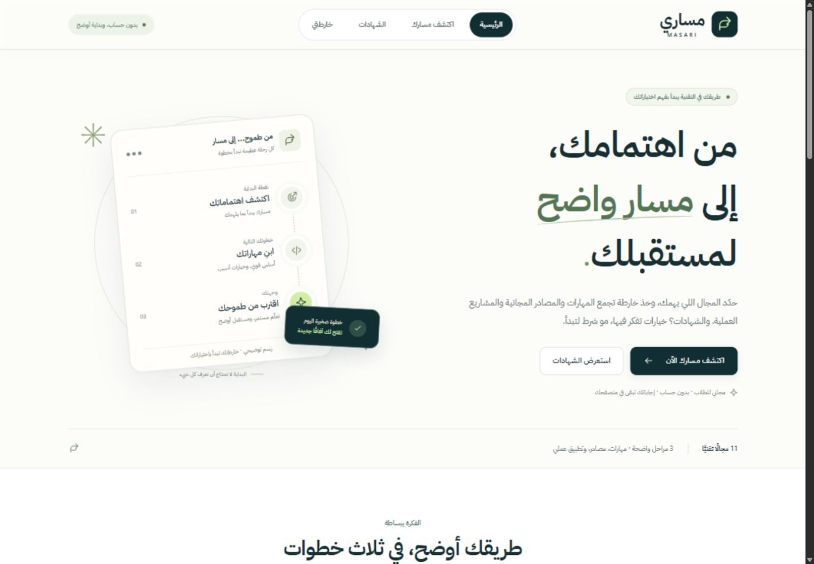
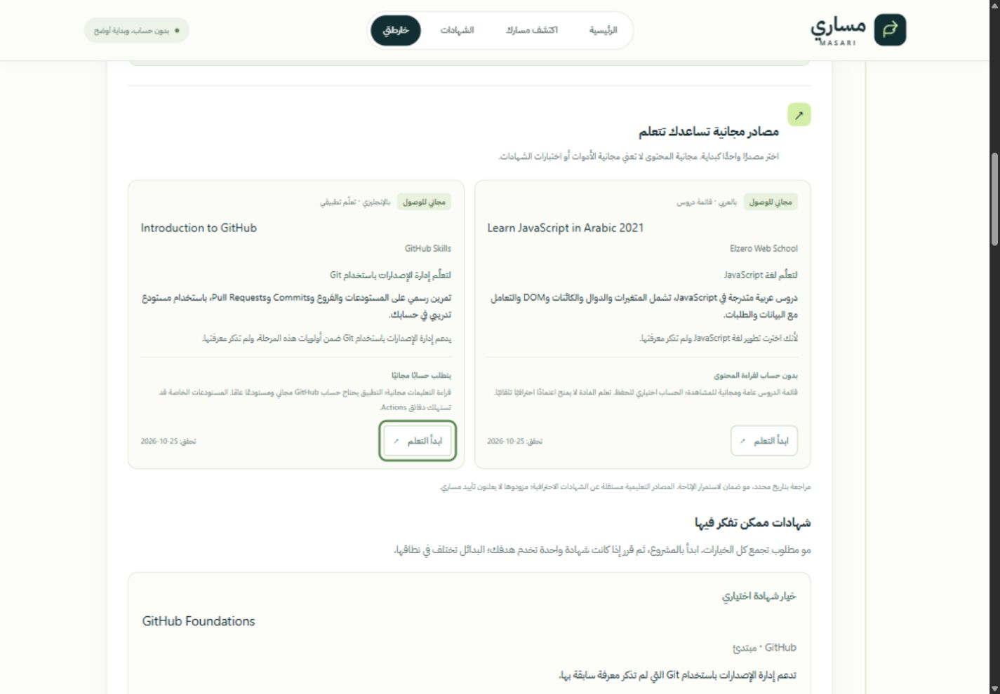

# Masari — مساري

An Arabic-first, anonymous career and certification guidance website for university students in computing-related majors. Masari helps students understand career options and learning credentials without promising employment or requiring an account.

**Current scope: Phase 5.** The static catalog contains **70 professional certifications**, **12 providers**, **11 career tracks**, **68 shared skills**, and **33 curated progression stages**. The anonymous questionnaire, rules-based personalized roadmaps and **39 curated free-access learning resources** now support self-reported learning progress, session restoration and optional device saving.

## Available features

- Arabic RTL homepage and responsive navigation, including an accessible mobile menu.
- Eleven concise career cards linking to the corresponding catalog category.
- Local certification catalog with one search field, one career-track filter, and a live result count.
- Search by credential name, exam code, provider, Arabic description, track, or canonical skill name. Arabic diacritics and common alef variants are normalized.
- Cards show issuer, credential type, broad guidance level, availability, dated verification, official links, and expandable preparation/skill information.
- Empty-result recovery and safe official links opening in a new tab.
- Four-step anonymous questionnaire with relevant skill selection, optional learning preferences, answer summary, editing, reset, and validated session restoration.
- Personalized three-stage roadmaps with prioritized skills, practical milestones, optional credential choices, reasons and prerequisite warnings.
- Friendly roadmap empty state and an application-level 404 page.
- Existing editorial templates provide the foundation for deterministic personalization; alternative cloud providers remain separate paths.
- Verified skill-linked learning resources: 9 Arabic and 30 English, covering 43 canonical skills across all 11 tracks.
- Refined responsive typography/cards and restrained GSAP/ScrollTrigger enhancement with reduced-motion support.
- Reversible skill, practical milestone and resource completion, honest activity counts, stage summaries and the next unfinished priority.
- Session-only progress by default; explicit device saving, confirmed resume/replacement, progress reset and persistent-data removal.
- Lightweight catalog, questionnaire, roadmap, learning-resource and progress validation included in every production build.

## Screenshots

Actual production-build screenshots captured on 2026-10-25. The roadmap uses sample anonymous answers.





Phase 5 activity summary, captured from the production preview on 2026-10-26 with synthetic student answers:


## Technology

React, Vite, strict TypeScript, React Router with HashRouter, ordinary CSS variables, npm, GitHub Actions, and GitHub Pages. Fonts and SVG icons are local. There is no backend, database service, paid API, AI service, authentication, or additional state-management library. Phase 4.5 adds only GSAP 3.15.0 for optional animation enhancement. No backend or recommendation service is required.

## Install and run

Use **Node.js 24 or later** and npm from the project directory:

```sh
npm ci
npm run dev
```

Open the local URL printed by Vite. Use `npm install` only when intentionally changing dependencies and the lockfile.

| Command                               | Purpose                                                                         |
| ------------------------------------- | ------------------------------------------------------------------------------- |
| `npm run dev`                         | Start development server                                                        |
| `npm run lint`                        | Run ESLint with zero allowed warnings                                           |
| `npm run typecheck`                   | Check application, Vite configuration, and validation script                    |
| `npm run validate:catalog`            | Validate credentials, providers, skills, tracks, templates, and search fixtures |
| `npm run validate:questionnaire`      | Check answer schema, taxonomy and storage error handling                        |
| `npm run validate:roadmap`            | Check deterministic personalization and optional credential rules               |
| `npm run validate:learning-resources` | Check resource metadata, references, safety and matching scenarios              |
| `npm run build`                       | Typecheck, validate data, and generate `dist/`                                  |
| `npm run preview`                     | Preview the production output locally                                           |

`npm run validate:progress` additionally checks activity identity/counting, answer reconciliation, opt-in, resume and storage failures. All five validators run during `npm run build`.

The validation scripts run directly through Node's built-in TypeScript support. No testing framework or TypeScript runner dependency is required.

## Anonymous questionnaire

Open `#/questionnaire`. Required academic major and year are followed by one student-selected career track, two independent skill selections, and optional self-assessed level, budget preference, and weekly study availability. Major does not constrain career choice. Skill options come from `Skill.tracks`; each selection may be empty and the same skill may appear in both. Changing tracks clears both selections with an inline explanation while keeping academic information and preferences.

Only complete, validated submissions are stored under `sessionStorage["masari_questionnaire_v1"]`. Reloading the same browser session restores the summary. Editing is in memory until resubmission; reloading during editing restores the last saved submission. Reset clears the saved result. Drafts are not autosaved and leaving the route discards unsaved edits. Answers do not synchronize across devices or go to a remote service. Browser session restoration policies may retain tabs; session storage is not a secure deletion guarantee.

Invalid JSON, obsolete identifiers, unrelated skills, duplicates within one selection, missing fields, and extra fields are rejected. Blocked reads/writes/deletion show an Arabic notice and preserve in-memory operation. If deletion is blocked, a previously saved submission may return on reload. Optional skipped preferences are `null`; no costs, eligibility, or certification learning times are inferred.

Implementation: `src/data/questionnaireOptions.ts`, `src/types/questionnaire.ts`, `src/utils/questionnaireValidation.ts`, `src/utils/questionnaireStorage.ts`, `src/pages/QuestionnairePage.tsx`, `src/components/questionnaire/`, and `src/styles/questionnaire.css`. Run `npm run validate:questionnaire` for dependency-free validation/storage checks; the same checks run during production builds. See `PHASE3_REPORT.md` for the full implementation and actual test coverage.

## Personalized roadmaps

After reviewing the submitted questionnaire, use **Create My Career Path** to open `#/roadmap`. `generatePersonalizedRoadmap` in `src/utils/generateRoadmap.ts` is a pure deterministic TypeScript function, not an AI service. It validates answers, reads the chosen track template, and returns the three existing stages in foundation → intermediate → advanced order. No current date, randomness, storage or network access affects the engine.

Within a stage, priority is: desired skills not reported known; other missing stage skills; known skills the student wants to deepen; remaining familiar skills. Familiarity never marks work complete. Priorities are assigned once across stages; repeated concepts remain labeled for deeper practice. Desired skills outside the displayed template appear in additional focus. Self-assessed level changes starting guidance without skipping missing foundations. Academic major/year supply context and do not restrict career choice. Projects come directly from the curated templates.

Only existing template credential IDs can be considered. Candidates must exist, be active, verified, relevant to the selected track, and suitable for the stage level. A lexicographic comparison favors missing desired skills, overlapping known/desired skills, then other missing track skills. Template order breaks ties. A stage highlights at most one optional credential with at most two collapsed alternatives; no suitable candidate means projects and skills remain the path. Reasons name actual skill matches. Official URLs, prerequisite text, dated verification and issuer notices resolve from the catalog. Advanced options are future goals. Eligibility is not inferred from free-form prerequisite notes, and passing an exam is distinguished from qualifying for the full credential.

Software-development and testing paths do not impose Python or Python credentials without a Python signal. Explicit desired JavaScript, TypeScript, Java or C# takes priority over Python reported only as familiar. Cloud preferences use desired `aws` / `azure` / `google-cloud` first, then known platforms. One clear platform keeps all three credential stages on that provider. Multiple interests expose those provider paths as parallel alternatives; no platform interest exposes all three without a default winner. These paths are collapsed groups after the shared skill/project stages, not an AWS → Azure → Google ladder. Other tracks exclude explicitly conflicting platform-specific credentials when there is one clear preference.

Budget preferences add an unknown-price note, never a cost filter or affordability claim. Weekly availability changes generic study advice, never a credential duration or calendar. All catalog prices remain unknown. These are optional learning choices, not employer guarantees or mandatory purchases.

Navigation passes validated answers through router state, allowing immediate generation even when sessionStorage is blocked. A direct route uses the active learning session, then validated questionnaire session answers, otherwise shows an Arabic questionnaire link and any available saved-roadmap resume action. The roadmap Edit action passes explicit edit intent to the existing form. Both edit and roadmap navigation payloads are consumed once so reloads use the current session rather than an old history snapshot. Generated recommendations are regenerated rather than persisted.

To maintain the rules, edit `generateRoadmap.ts` and add representative assertions to `scripts/validate-roadmap.ts`. Adjust the existing editorial template when its learning sequence changes; never invent IDs or bypass catalog validation. Candidate selection is deliberately bounded to curated IDs rather than every catalog match. Run `npm run validate:roadmap`; it also runs during `npm run build`. `src/types/roadmap.ts` stores canonical IDs, stage metadata, focus categories, optional credential explanations and provider paths without copying credential records. `src/components/roadmap/` and `src/styles/roadmap.css` render the Arabic RTL interface. See `PHASE4_REPORT.md` for examples, coverage and limitations.

## Free learning resources

The separate `src/data/learningResources.ts` catalog contains 39 manually reviewed resources: 2 YouTube playlists, 16 online courses, 5 interactive tutorials and 16 official documentation resources. No unverified individual video URL was added. It is independent from the 70 professional credentials. Each resource references canonical skills/tracks, language, editorial level, actual publisher, HTTPS destination, dated free-access verification and account/access caveats.

`recommendLearningResources` supplements the existing generated roadmap without changing certification rules. It favors missing desired skills, missing stage skills, then known/desired deepening; additional interests outside template stages are routed to a suitable stage. Eligible resources need verified free access, a direct matching skill and track relevance. Stage level and optional self-assessment guide suitability, Arabic is preferred among eligible choices, and explicit language/platform interests prevent incompatible tutorials from being substituted. It selects up to four resources per stage, one per selected priority skill, and does not repeat a resource across stages. Missing coverage leaves skills/projects intact with an honest empty state.

Free access means the stated learning content, not a paid exam, software license, cloud laboratory, compute quota or guaranteed certificate. Registration requirements and constraints are shown on each card. Nothing queries YouTube or a course service from the student's browser; links open the verified publisher destination. External publishers have their own account/privacy terms; questionnaire answers are not attached to links. There are no video embeds, scraped feeds or API credentials.

See [resource maintenance](docs/learning-resources.md), [manual verification evidence](docs/resource-verification.json) and [Phase 4.5 report](PHASE4_5_REPORT.md). Public availability can change; verify the actual page before updating dates or claiming free access.

## Animation and visual enhancement

`src/hooks/usePageMotion.ts` lazily imports GSAP 3.15.0 and ScrollTrigger only when the current page has reveal targets. The homepage hero and selected section/card blocks receive brief vertical/opacity reveals; roadmap headings retain restrained reveals within the three-stage timeline. Stateful roadmap controls and their containing stage blocks are excluded from GSAP. Ordinary hover/focus, form selection, completion feedback and menu presentation use CSS. Catalog results and all 70 cards are not individually scroll-animated.

All selectors are scoped to the current main element. GSAP match-media context reverts animations and ScrollTriggers when preferences or navigation entries change; a disposal guard prevents late asynchronous imports from touching an unmounted page. Reduced-motion preference skips the imports initially and reverts active motion on a preference change. Content starts visible and never depends on animation success. No Arabic text splitting, pinning, scroll hijacking or persistent animation state is used. See [animation implementation and licensing](docs/animation-notes.md).

## Anonymous learning progress

Roadmaps offer two-state checkboxes for each displayed canonical skill (including additional interests), each practical stage milestone, and each recommended learning resource. They are manual, reversible self-reports. Existing questionnaire knowledge is never automatic completion; opening an external resource never completes it. No professional credential completion or eligibility marker is stored, and the certification engine is unchanged.

The summary counts unique skills, the three practical milestones, and unique displayed resources. A skill shared between stages has synchronized controls and counts only in its first displayed stage. Additional skills outside the template count in the final stage. Every displayed resource is a tracked activity, not a mandatory course or purchase. Credentials and their alternatives never enter the denominator. The percentage is explicitly labeled **نسبة إنجاز الأنشطة المحددة** and measures recorded activities only, not mastery or employability. Next activity follows stage order, prioritized skills, remaining stage skills, resources, then the practical milestone; additional skills follow the stages. Its button focuses the actual checkbox.

One active roadmap is held in a small browser-memory store exposed through React's built-in `useSyncExternalStore`. `sessionStorage["masari_learning_session_v1"]` stores validated answers and progress for the current session. It is separate from the questionnaire submission key. Resetting the questionnaire alone does not remove an existing learning session or device snapshot. The header's **خارطتي** returns to the active roadmap. Browser session restoration may preserve session data longer than a single window lifetime.

Only checking **حفظ مساري وتقدمي على هذا الجهاز**, with confirmation when a snapshot already exists, writes `localStorage["masari_learning_device_v1"]`. The version-1 envelope stores `deviceOptIn: true`, minimum validated questionnaire answers and progress IDs; it contains no generated certification text or React structures. The progress schema has version, track ID, completed canonical skill IDs, stable `track:stage:practice` milestone IDs and resource IDs. No identifying information, timestamps, account, remote synchronization or backend is introduced.

The homepage and an empty roadmap offer **متابعة مساري السابق** for a valid opted-in device snapshot. Resume requires confirmation and regenerates recommendations through the existing engine. It replaces the active learning session without writing over the questionnaire's separately saved submission. One device snapshot is supported, with no multi-profile history. Other users of the browser profile can access it; browser-data clearing can remove it permanently. This storage is not encrypted or independent evidence of completion.

When answers change within the same track, keep only completed skills, milestones and resources still present in the regenerated activity set. Removed IDs are discarded, and newly relevant activities start incomplete. A different track starts a fresh scope, even for shared skills; changing back does not recover an older active scope automatically. Every answer change pauses device saving and leaves the old snapshot untouched until explicit confirmed replacement or removal. Skill-array reordering alone does not constitute an answer change. Recommendation/template maintenance can change the denominator; IDs are revalidated against current catalogs and generated activities on restore.

**تصفير تقدم هذه الخارطة** asks for confirmation and clears only active completion (also updating its device snapshot if enabled). **مسح بيانات التعلم المحفوظة من هذا الجهاز** asks for confirmation and removes all persistent Masari learning data while retaining session progress. Unchecking the device-save option removes the same persistent key immediately. If removal fails, the UI explicitly warns that old data may remain; use the browser's site-data settings or retry. There is no silent claim of successful deletion.

Malformed shapes, duplicates and unsupported versions are rejected. Obsolete or irrelevant activity IDs are pruned. Restored questionnaire answers must pass the existing validator before regeneration. Storage getter, read, write and deletion failures are caught; the active session remains functional in memory across route navigation, but reload can lose unsaved work. Different saved answers written by another tab are checked before automatic updates/replacement. Concurrent edits to the same answers are last-write-wins; there is no cross-tab synchronization or merge system.

Implementation: `src/types/progress.ts`, pure `roadmapProgress.ts`, storage adapters in `progressStorage.ts`, the injectable `progressStore.ts`, `useLearningProgress.ts`, compact roadmap components and `progress.css`. Run `npm run validate:progress`; it is included in every production build. See [Phase 5 technical report](PHASE5_REPORT.md) for actual browser evidence and limitations.

## Routes

| Hash route                                | Page                                              |
| ----------------------------------------- | ------------------------------------------------- |
| `#/`                                      | Homepage                                          |
| `#/certifications`                        | Searchable certification catalog                  |
| `#/certifications?track=software-testing` | Catalog with a selected career track              |
| `#/questionnaire`                         | Anonymous student questionnaire                   |
| `#/roadmap`                               | Personalized roadmap or questionnaire empty state |
| Any other application route               | 404 with working return link                      |

## Data and source structure

```text
src/
  data/                   # Credentials/providers, canonical skills/tracks/templates, learning resources
  types/                  # Questionnaire, generated roadmap and learning-resource contracts
  utils/                  # Pure generation/matching, validators, session and router handling
  hooks/usePageMotion.ts  # Scoped optional GSAP enhancement
  components/
    layout/               # Brand, header and footer
    certifications/       # Searchable catalog cards
    questionnaire/        # Skill selectors and answer summary
    roadmap/              # Stages, optional credentials and free learning resources
    ui/                   # Existing shared icons and UI
  pages/                  # Homepage, catalog, questionnaire, roadmap and 404
  styles/                 # Existing tokens plus scoped page/resource/refinement styles
scripts/                  # Four dependency-free validation suites
.github/workflows/deploy.yml
docs/                     # Resource/animation maintenance, evidence and real screenshots
PHASE4_5_REPORT.md
```

## Maintaining the catalog

1. Open the actual issuer page and confirm the official name, issuer, assessment type, availability, exam version, and any mandatory prerequisites. A search snippet or a working URL alone is not verification.
2. Add or update a `Certification` in `src/data/certifications.ts`. Keep its stable ID when the exam version changes. All original Phase 2 IDs are retained.
3. Reference an existing `providerId`, career-track IDs, and `skillIds`. Do not add free-form skill names to certification records. Add a genuinely distinct skill once in `skills.ts` and reuse its ID.
4. Add new issuers to `providers.ts` with their official website and approved `sourceDomains`. GitHub certifications are officially hosted on Microsoft Learn; CNCF works with The Linux Foundation. Domain approval is not a substitute for reading the source.
5. Set `verified` and the actual `lastVerifiedAt` date only after direct inspection. Use `pending` with `lastVerifiedAt: null` when not checked, `unknown` for unconfirmed availability, and `null` for unknown optional fields. Retired and unknown records have explicit UI labels.
6. Distinguish mandatory exam/certification/experience requirements from recommended preparation. Passing a professional exam does not necessarily satisfy the requirements to receive the full credential, particularly for experience-based ISC2 certifications or Microsoft Expert certifications.
7. Do not infer fees, currency conversions, Saudi pricing, free exams, HRDF support, or reimbursement. Current `examPrice` and `currency` values are all `null`, meaning unverified rather than free.
8. Record material issuer notices in `notesAr`. AWS Developer and Solutions Architect Professional, some Python exams, and selected Microsoft exam objectives have upcoming changes noted in the current snapshot. Recheck the live issuer page before booking.
9. Run the quality commands before publishing:

```sh
npm run lint
npm run typecheck
npm run validate:catalog
npm run validate:questionnaire
npm run validate:roadmap
npm run validate:learning-resources
npm run build
```

The current snapshot was manually reviewed on **2026-10-25**. Verification is dated, not continuous monitoring. Broad beginner/intermediate/advanced levels and skill/track mappings are Masari editorial classifications, not universal issuer difficulty ratings.

## Skills and progression policy

`skills.ts` defines 68 reusable skills. Each has one stable English ID, an Arabic student-facing name, an English name, and associated tracks. Track `skillIds` are derived from those associations to avoid two inconsistent lists. The old certification `skills` strings were migrated to `skillIds`; the existing 12 records keep their identities and official references.

Each template in `roadmapTemplates.ts` contains exactly **foundation → intermediate → advanced**, with skill references, a practical milestone, and zero or more optional certification IDs. `certificationChoice: "optional-options"` means that no purchase is mandatory and options may cover different roles. Foundational cloud credentials are alternative vendor choices; students generally do not need all three. Advanced stages have `futureGoal: true` and remain subject to issuer eligibility and real experience.

Templates are editorial learning sequences, **not issuer-mandated prerequisites** or automatic recommendations. Empty certification arrays are intentional where practice is more appropriate: advanced web development, intermediate AI, and advanced IT support currently use project milestones without a credential suggestion. The validator rejects inactive/unverified suggestions, mismatched track references, inappropriate advanced foundation suggestions, and invalid skill references.

The questionnaire consumes these canonical track and skill IDs directly. It does not request identifying information or an account. The generated roadmap and progress tracker reuse the same IDs. Device saving requires explicit opt-in; no numeric proficiency scoring is implemented.

## Deployment

- Repository: [Mohammed-Alharbi-1/masari](https://github.com/Mohammed-Alharbi-1/masari)
- Site: [Masari](https://mohammed-alharbi-1.github.io/masari/)
- Branch: `main`

GitHub Pages is configured to use GitHub Actions. The existing workflow follows the repository's actual default branch, runs `npm ci`, lint, and build, uploads `dist/`, and deploys with the official Pages actions. Catalog, questionnaire, roadmap, learning-resource and progress validation are included through the build command.

For a fork or a new repository, select **Settings → Pages → Build and deployment → Source → GitHub Actions**, and allow the default branch in the `github-pages` environment if protection rules apply. Push to the default branch or run the workflow manually from it. Confirm the actual Actions result; a local build alone does not verify remote publication.

`vite.config.ts` derives the project asset base from `GITHUB_REPOSITORY`. Renaming a repository requires a rebuild, not a hardcoded source change. User-site repositories ending in `.github.io` use `/`. For a custom domain, set `VITE_BASE_PATH: /` in the build environment and configure the domain separately.

To test a different repository path in PowerShell:

```powershell
$env:GITHUB_REPOSITORY = 'example/renamed-repository'
npm run build
npm run preview
# Open /renamed-repository/ on the printed preview server
Remove-Item Env:GITHUB_REPOSITORY
```

Rebuild after removing the variable to restore a root-path local build. HashRouter keeps client routes after `#`; fonts are processed by Vite and the favicon uses `BASE_URL`. See the [official Vite deployment guide](https://vite.dev/guide/static-deploy#github-pages).

## Deferred work and verification limits

Phase 5 adds anonymous local learning progress to the existing resources and personalized guidance. No accounts, cloud sync, course playback monitoring, verified credentials, gamification or notifications are implemented. Final quality and release work remain outside this phase. Self-reports cannot establish learning quality, professional competence, certification success or employment readiness.

The validator checks internal consistency and source domains, not source freshness or educational suitability. The catalog is cloud-heavy and some areas rely more on practical projects than paid credentials. Technical reports document exclusions, coverage, actual commands, browser checks, and publication state. Historical Phase 1/2 reports retain their original language and pre-publication snapshots; new technical documentation is in English.

IBM Plex Sans Arabic is bundled through Fontsource. Its SIL Open Font License is included in `public/fonts/OFL.txt`. No external images, issuer logos, or font-service requests are required during browsing.
